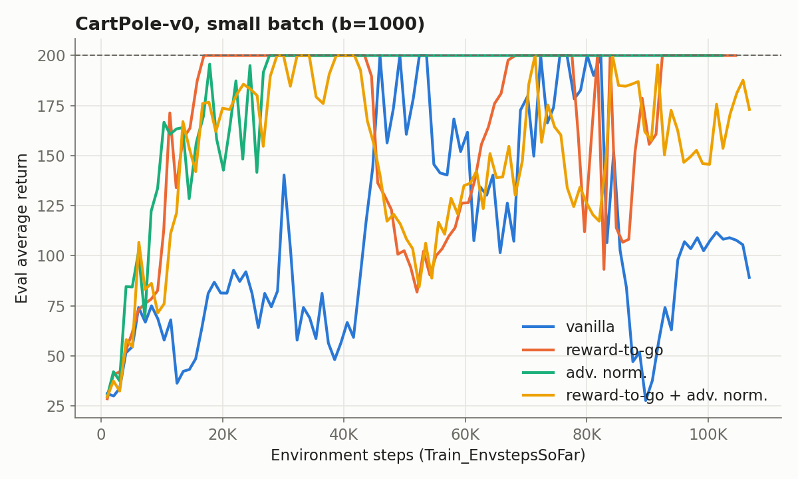
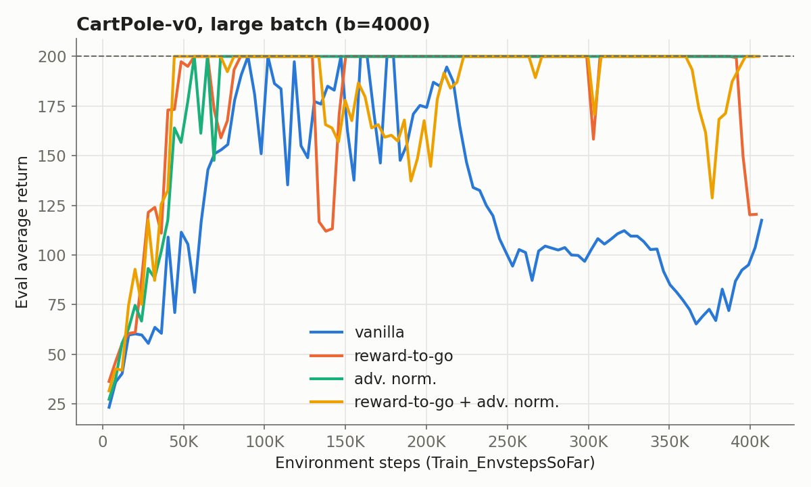
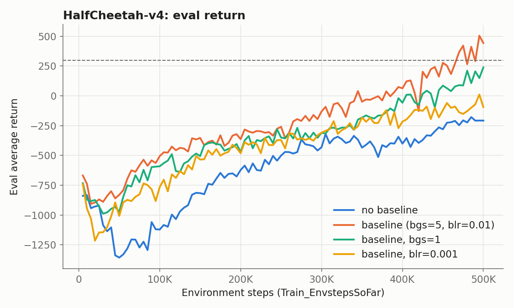
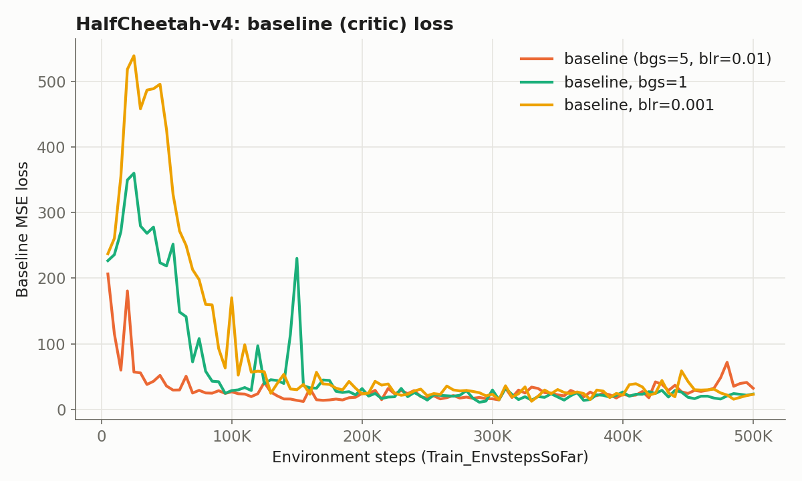
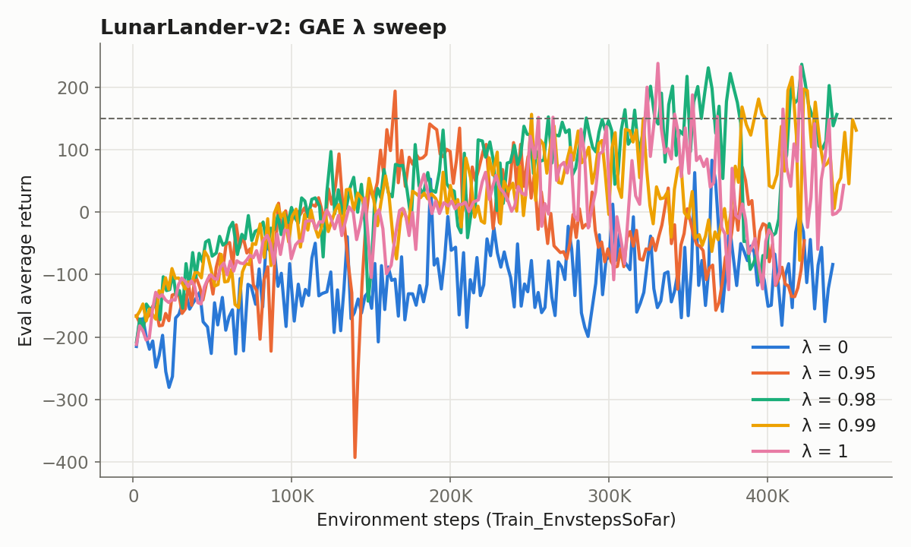
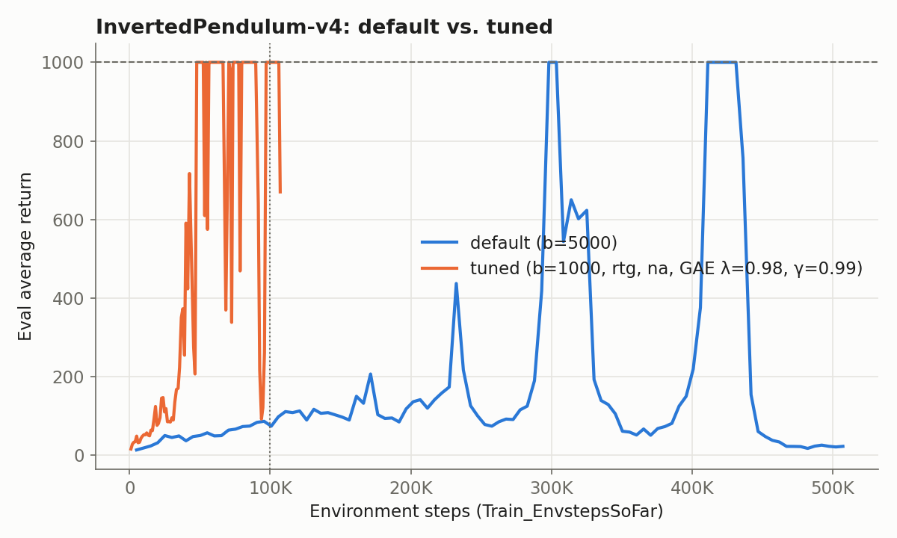

# HW2: Policy Gradients

Implementation and experiments for [CS 285 (UC Berkeley, Spring 2026)](https://rail.eecs.berkeley.edu/deeprlcourse/) Homework 2. I worked through it as a self-study student, running every experiment locally on a laptop CPU.

**What I implemented**

- Vanilla policy gradient (REINFORCE) with discrete (`Categorical`) and continuous (diagonal Gaussian) policies
- Return estimators: full-trajectory discounted return and discounted reward-to-go
- Advantage normalization
- A neural-network value baseline (critic) trained by MSE regression on reward-to-go targets
- Generalized Advantage Estimation (GAE-λ), with trajectory boundaries handled in a flattened batch

| Experiment | Target | Result |
|---|---|---|
| 1. CartPole-v0 | best config reaches 200 (small and large batch) | ✅ reached 200 in every config |
| 2. HalfCheetah-v4 + baseline | eval return > 300 at end of training | ✅ final 443 (last-10 mean 342) |
| 3. LunarLander-v2 + GAE | best run > 150 at least once | ✅ max 237 (λ = 0.98) |
| 4. InvertedPendulum-v4 tuning | return 1000 within 100K env steps | ✅ first hit at **47.8K** steps (default: 298K) |

Figures are generated from the run logs with [`report/plot_results.py`](report/plot_results.py). The x-axis of every learning curve is environment steps (`Train_EnvstepsSoFar`), not iterations. All returns are `Eval_AverageReturn`.

---

## Experiment 1: CartPole-v0

Eight runs of 100 iterations each: a small batch (`-b 1000`, ~100K steps) and a large batch (`-b 4000`, ~400K steps), each combined with reward-to-go (`-rtg`) and advantage normalization (`-na`) on or off.




| Config | Small batch: first 200 @ steps | Small: last-10 mean | Large batch: first 200 @ steps | Large: last-10 mean |
|---|---|---|---|---|
| vanilla | 45.9K | 105 | 89.8K | 86 |
| rtg | **16.9K** | **200** | 56.7K | 179 |
| na | 27.7K | **200** | 56.7K | **200** |
| rtg + na | 29.0K | 164 | **44.3K** | 179 |

### Implementation

- **Both return estimators (Eq. 25 and Eq. 26) are applied per trajectory.** The batch arrives as a list of trajectories, and I compute Q-values on each one before flattening. If Q-values were computed on the flattened batch, rewards would leak across episode boundaries.
- **Reward-to-go uses a backward recursion**, `G_t = r_t + γ G_{t+1}`. This is O(T), whereas summing the suffix `rewards[t:]` separately for every t would be O(T²).
- **Advantage normalization uses statistics from the whole flattened batch**, `(A − μ) / (σ + 1e-8)`, as in Eq. 24.
- **The policy outputs a distribution**, `Categorical(logits=...)`. The actor loss is the surrogate `−mean(log π(a|s) · A)`. Its gradient is the policy gradient, but its value is not a performance measure.

### Analysis

#### Reward-to-go vs. the trajectory-centric estimator

Without advantage normalization, the reward-to-go estimator clearly outperformed the trajectory-centric one at both batch sizes. In the small-batch setting it reached the maximum return of 200 after only 16.9K steps, about 2.7× faster than the trajectory-centric estimator (45.9K), and it stayed at 200 through the end of training. The trajectory-centric estimator touched 200 a few times but never settled: its last-10 mean was 105 for small batches and 86 for large batches.

#### Why reward-to-go is preferred

An action taken at time t cannot change rewards that were already received, yet the trajectory-centric estimator multiplies every $`\nabla_\theta \log(\pi(a_t \mid s_t)`$ by the full return, past rewards included. In expectation those past-reward terms contribute zero gradient, but in any finite batch they add noise. Reward-to-go removes them, so the estimator stays unbiased and its variance drops. The faster, steadier curves are that variance reduction showing up in practice.

#### Advantage normalization

Normalization helped substantially, most of all for the trajectory-centric estimator: its last-10 mean jumped from 105 to 200 with small batches and from 86 to 200 with large batches. The reason is specific to CartPole's reward structure. Every reward is +1, so raw returns are always positive, and every update raises the probability of every sampled action. Only the relative sizes of the updates differ. Normalizing centers the advantages around zero, so actions from shorter-than-average episodes receive negative advantages and are actively discouraged. When reward-to-go was already in use, normalization added less. In the small-batch rtg+na run, the policy reached 200 but oscillated afterwards; I attribute this mostly to single-seed noise rather than to normalization hurting.

#### Batch size

Batch size mattered in two opposite ways. Per update, the large batch gave smoother curves and more reliable convergence: three of the four large-batch configurations finished at or near 200, against two of four with the small batch. Per environment step, however, the small batch was more efficient: every configuration reached 200 sooner in steps with `-b 1000`, because each large-batch update consumes four times as much data. A larger batch reduces gradient variance but spends more samples on each step, and this trade-off shows up again in Experiment 4.

<details>
<summary>Commands</summary>

```bash
uv run src/scripts/run.py --env_name CartPole-v0 -n 100 -b 1000 --exp_name cartpole
uv run src/scripts/run.py --env_name CartPole-v0 -n 100 -b 1000 -rtg --exp_name cartpole_rtg
uv run src/scripts/run.py --env_name CartPole-v0 -n 100 -b 1000 -na --exp_name cartpole_na
uv run src/scripts/run.py --env_name CartPole-v0 -n 100 -b 1000 -rtg -na --exp_name cartpole_rtg_na
uv run src/scripts/run.py --env_name CartPole-v0 -n 100 -b 4000 --exp_name cartpole_lb
uv run src/scripts/run.py --env_name CartPole-v0 -n 100 -b 4000 -rtg --exp_name cartpole_lb_rtg
uv run src/scripts/run.py --env_name CartPole-v0 -n 100 -b 4000 -na --exp_name cartpole_lb_na
uv run src/scripts/run.py --env_name CartPole-v0 -n 100 -b 4000 -rtg -na --exp_name cartpole_lb_rtg_na
```
</details>

---

## Experiment 2: HalfCheetah-v4 with a neural-network baseline

All runs use reward-to-go, γ = 0.95, `-lr 0.01`, and no advantage normalization, so the baseline is the only variance-reduction difference between them.




| Run | Final eval return | Last-10 mean | Max |
|---|---|---|---|
| no baseline | −208 | −213 | −178 |
| **baseline (bgs = 5, blr = 0.01)** | **443** | **342** | **505** |
| baseline, bgs = 1 | 239 | 127 | 239 |
| baseline, blr = 0.001 | −94 | −92 | 11 |

### Implementation

- **The continuous policy is `Independent(Normal(mean, exp(logstd)), 1)`.** A HalfCheetah action is a 6-dimensional vector, and the policy gradient needs one `log π(a|s)` per timestep. `Independent` sums the per-dimension log-probs into one scalar, so the result has shape `(B,)` and matches the advantages. Parameterizing the standard deviation as `exp(logstd)` keeps it positive while `logstd` is learned without constraints.
- **The critic is a regression model.** It is trained with MSE loss on the reward-to-go targets, taking `baseline_gradient_steps` steps per policy update. Its `(B, 1)` output is squeezed to `(B,)`. Without the squeeze, `values − q_values` would silently broadcast into a `(B, B)` matrix.
- **Advantages are computed in NumPy.** Converting the critic's output with `to_numpy` cuts the autograd graph. This keeps `A = Q − V` a constant in the actor loss, so the actor's gradient never flows into the critic.

### Analysis

#### Effect of the baseline

The learned baseline made a large difference. Without it, the agent improved slowly and finished at −208. With it, the agent ended training at 443, above the 300 target, with a last-10 mean of 342. Subtracting `V(s)` from the reward-to-go leaves the expected gradient unchanged, since the baseline does not depend on the action. What it changes is the scale of the advantage: an action's signal becomes "how much better than usual from this state" instead of the raw return, which is dominated by the state itself. The eval-return curve shows that lower variance as faster, steadier improvement.

The baseline-loss curve shows the critic learning in the default setting. The MSE drops from about 200 to about 30 within the first 50K steps, then stays roughly flat while the policy, and with it the return targets, keeps changing.

#### Seed variance

I ran the baselined configuration five times with identical hyperparameters (seed 1 twice, then seeds 2 to 4). The final returns were 101, 204, −216, 266, and 443. The plotted run is seed 4, the first to clear 300 at the end of training. Even two runs with the same seed differed, because the starter code seeds NumPy and PyTorch but not `env.reset()`. The assignment expects one or two bad runs, and this spread is why single-run comparisons below should be read as trends.

#### Weakening the critic: (a) baseline learning curve

To isolate how much the critic's accuracy matters, I reran the seed-4 configuration twice: once with fewer baseline gradient steps (`-bgs 1`), and once with a 10× smaller baseline learning rate (`-blr 0.001`).

The effect on the baseline learning curve was immediate. With either change, the critic could not keep up with the policy early in training. Instead of falling, the loss *rose* to about 360 (`bgs=1`) and 540 (`blr=0.001`), and it took roughly 100K steps to come down to the level the default critic had reached by 50K. Late in training, all three losses sit around 20 to 30. Those late values are not directly comparable, however: a worse policy earns smaller returns, so its critic has smaller-magnitude targets to fit.

#### Weakening the critic: (b) policy performance

The policy's performance followed the critic's accuracy. While the critic is inaccurate, the baseline subtracts the wrong amount, so the advantages stay noisy and the policy gradient is less informative. The `bgs=1` run still learned, ending at 239. The `blr=0.001` run, whose critic lagged the longest, barely improved and ended near −90. A baseline helps only to the extent that the critic actually tracks V(s).

<details>
<summary>Commands</summary>

```bash
# No baseline
uv run src/scripts/run.py --env_name HalfCheetah-v4 -n 100 -b 5000 -eb 3000 -rtg \
  --discount 0.95 -lr 0.01 --exp_name cheetah
# Baseline (submitted run)
uv run src/scripts/run.py --env_name HalfCheetah-v4 -n 100 -b 5000 -eb 3000 -rtg \
  --discount 0.95 -lr 0.01 --use_baseline -blr 0.01 -bgs 5 --exp_name cheetah_baseline --seed 4
# Weaker critic
uv run src/scripts/run.py --env_name HalfCheetah-v4 -n 100 -b 5000 -eb 3000 -rtg \
  --discount 0.95 -lr 0.01 --use_baseline -blr 0.01 -bgs 1 --exp_name cheetah_baseline_bgs1 --seed 4
uv run src/scripts/run.py --env_name HalfCheetah-v4 -n 100 -b 5000 -eb 3000 -rtg \
  --discount 0.95 -lr 0.01 --use_baseline -blr 0.001 -bgs 5 --exp_name cheetah_baseline_blr0.001 --seed 4
```
</details>

---

## Experiment 3: LunarLander-v2 with GAE

A sweep over λ ∈ {0, 0.95, 0.98, 0.99, 1} with all other hyperparameters fixed as specified (200 iterations, batch 2000, γ = 0.99, baseline on).



| λ | Max eval return | Last-20 mean | First > 150 at iter |
|---|---|---|---|
| 0 | 83 | −100 | never |
| 0.95 | 194 | −60 | 74 |
| **0.98** | **237** | **119** | 116 |
| 0.99 | 217 | 105 | 109 |
| 1 | 239 | 50 | 113 |

### Implementation

- **GAE uses a backward recursion over the flattened batch**, `A_t = δ_t + γλ A_{t+1}` with `δ_t = r_t + γV(s_{t+1}) − V(s_t)`.
- **`terminals` cuts the recursion at trajectory boundaries.** After a trajectory's last step, the next index in the flattened array belongs to a different trajectory. At those steps I drop both the bootstrap term and the recursive term, so `δ_{H−1} = r_{H−1} − V(s_{H−1})`.
- **I verified the implementation against its two closed forms.** On a batch of two trajectories, λ = 1 reproduced `Q − V` exactly, and λ = 0 reproduced the one-step TD error δ_t exactly. Both limiting cases matched before I ran the sweep.

### Analysis

#### Effect of λ on performance

The sweep separates into three behaviors. At λ = 0 the agent never learned to land: its return stayed negative for the whole run and peaked at 83. Every λ ≥ 0.95 exceeded the 150 target at least once. Among those, λ = 0.98 and 0.99 were the most reliable: they kept returns above 100 over the last 20 iterations and ended at 157 and 132. λ = 1 matched them in peak return (239) but swung widely, falling from 85 at iteration 150 to 43 at the end. λ = 0.95 crossed 150 earliest but collapsed late in training; with only one seed, I treat that collapse as partly noise.

#### λ = 0 and λ = 1 as limiting cases

These two extremes explain the pattern. With λ = 0, GAE reduces to the one-step TD error `δ_t = r_t + γV(s_{t+1}) − V(s_t)`. Only one real reward enters the estimate, and everything after it is the critic's guess. This is the lowest-variance estimator, but it is only as good as the critic. Early in training the critic is poor, so the advantages are heavily biased, and the policy never got a useful learning signal.

With λ = 1, the δ terms telescope into `G_t − V(s_t)`: the Monte Carlo reward-to-go minus the baseline, exactly the estimator from Experiment 2. It is unbiased, because it uses all the real rewards, but in a 1000-step, noisy-action environment those full returns are high-variance, which is the instability visible in the λ = 1 curve.

Intermediate values such as 0.98 and 0.99 trade a small amount of bias for a large reduction in variance, so on LunarLander they gave both a high peak and stable late-training performance.

<details>
<summary>Command</summary>

```bash
uv run src/scripts/run.py --env_name LunarLander-v2 --ep_len 1000 --discount 0.99 \
  -n 200 -b 2000 -eb 2000 -l 3 -s 128 -lr 0.001 --use_reward_to_go --use_baseline \
  --gae_lambda <lambda> --exp_name lunar_lander_lambda<lambda>
# <lambda> ∈ {0, 0.95, 0.98, 0.99, 1}
```
</details>

---

## Experiment 4: Hyperparameter tuning on InvertedPendulum-v4

The goal is to reach a return of 1000 within **100K environment steps**. With the default settings, this takes about 300K.



| Config (tuned runs all use `-rtg -na`) | First eval = 1000 @ steps | # evals at 1000 within 100K | Outcome |
|---|---|---|---|
| default: `-b 5000` | 298K | 0 | max 86 within 100K |
| A: `-b 1000 -lr 0.01` | 80.3K | 11 | stable at 1000 at end |
| B: `-b 1000 -lr 0.02` | 58.4K | 4 | collapsed to ~40 afterwards |
| C: `-b 500 -lr 0.01` | — | 0 | too noisy, max 262 |
| **D: `-b 1000 -lr 0.01` + baseline, GAE λ = 0.98, γ = 0.99** | **47.8K** | **36** | **best** |
| E: `-b 2000 -lr 0.02` | — | 0 | too few updates, max 377 |

### Analysis

#### Best configuration

My best run (D) first reached 1000 after **47.8K environment steps**, six times faster than the default, and held 1000 at 36 of the evaluations within the 100K budget:

```bash
uv run src/scripts/run.py --env_name InvertedPendulum-v4 -n 100 -b 1000 -eb 1000 \
  -rtg -na -lr 0.01 --discount 0.99 --use_baseline --gae_lambda 0.98 --exp_name pendulum_D_b1000_gae
```

#### Batch size

The budget is counted in environment steps, not iterations. That made batch size the most important choice. At the default `-b 5000`, 100K steps buy only 20 policy updates, and within that budget the default run never got past a return of 86. Dropping to `-b 1000` buys 100 updates for the same data. There was a floor, though: at `-b 500` the gradient estimates were too noisy to learn at all, and `-b 2000` allowed too few updates. A batch of 1000 was the best balance in my sweep.

#### Learning rate

The learning rate traded speed for stability. Doubling it to 0.02 (B) reached 1000 sooner than 0.01 (A), at 58K versus 80K steps, but the policy then collapsed to around 40 and never recovered. Run A was slower but held 1000 through the end of training.

#### Variance reduction

The remaining gain came from variance reduction, which is what makes small batches viable. Reward-to-go and advantage normalization were on in every tuned run. Adding a critic baseline with GAE (λ = 0.98) and γ = 0.99 on top of A moved the first hit from 80K to 48K steps and tripled the number of evaluations at 1000. With fewer samples per update, each update needs lower-variance advantages to be useful.

#### Instability of the default run

The default run's full curve is a reminder of how unstable plain policy gradients can be. It eventually reached 1000 twice, around 300K and 410K steps, but collapsed to about 20 by the end of training.

<details>
<summary>Default command</summary>

```bash
uv run src/scripts/run.py --env_name InvertedPendulum-v4 -n 100 -b 5000 -eb 1000 --exp_name pendulum
```
</details>

---

## Takeaways

- Policy gradient performance is dominated by **gradient variance**. Every technique that helped (reward-to-go, normalization, baselines, GAE, discounting) is a variance-reduction tool. Each one trades off differently against bias or sample cost.
- **Results vary heavily with the random seed.** Identical HalfCheetah configs ranged from −216 to 443. Conclusions from single runs should be treated as trends, and real comparisons need multiple seeds.
- **Sample efficiency is about the number of updates per environment step**, not the number of iterations. Smaller batches plus stronger variance reduction made InvertedPendulum about 6× more sample-efficient than the default.

---

## Setup

This project uses [`uv`](https://docs.astral.sh/uv/). Always run scripts through `uv run`.

```bash
uv sync
uv run wandb login          # optional: experiment tracking
uv run src/scripts/run.py --help
uv run report/plot_results.py   # regenerate figures from exp/*/log.csv
```

On macOS, if building `box2d-py` fails because of a custom `CC`/`CXX` compiler setting, run `CC=clang CXX=clang++ uv sync`.
