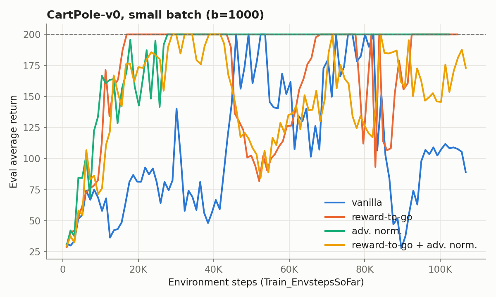
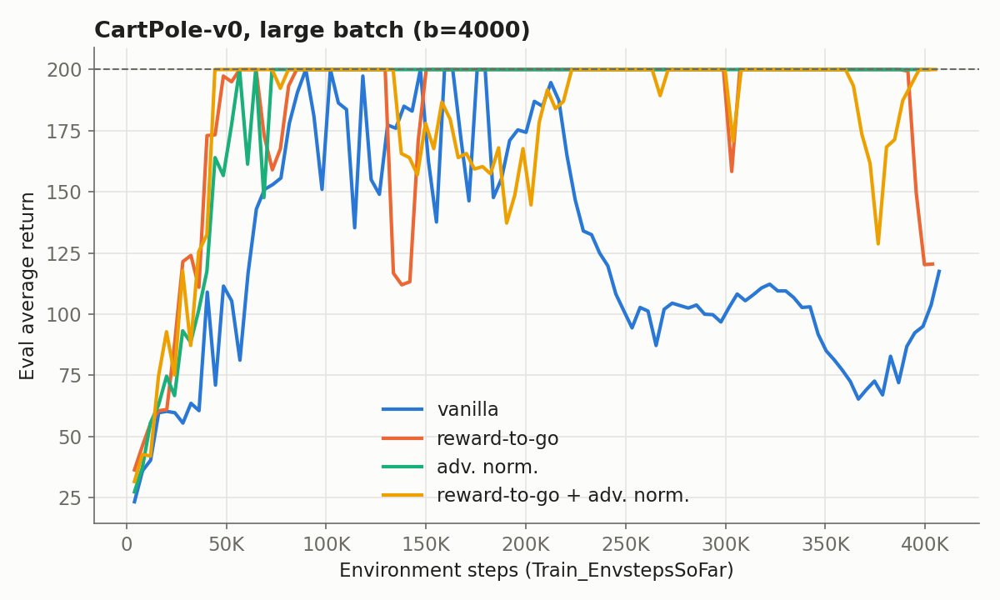
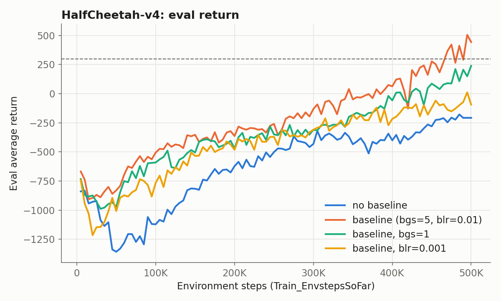
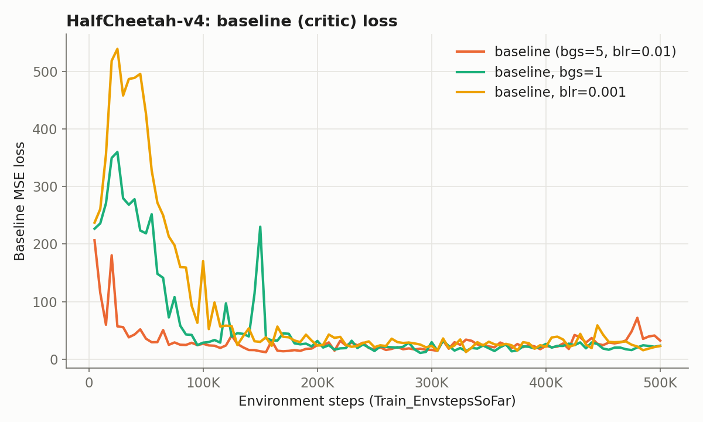
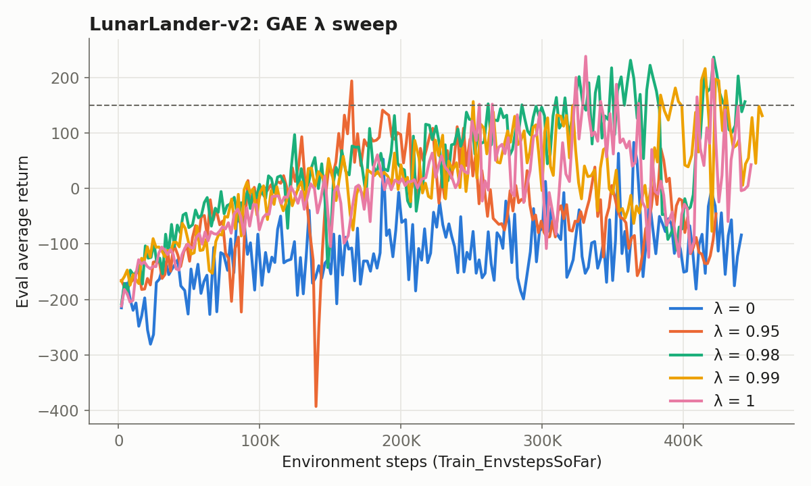
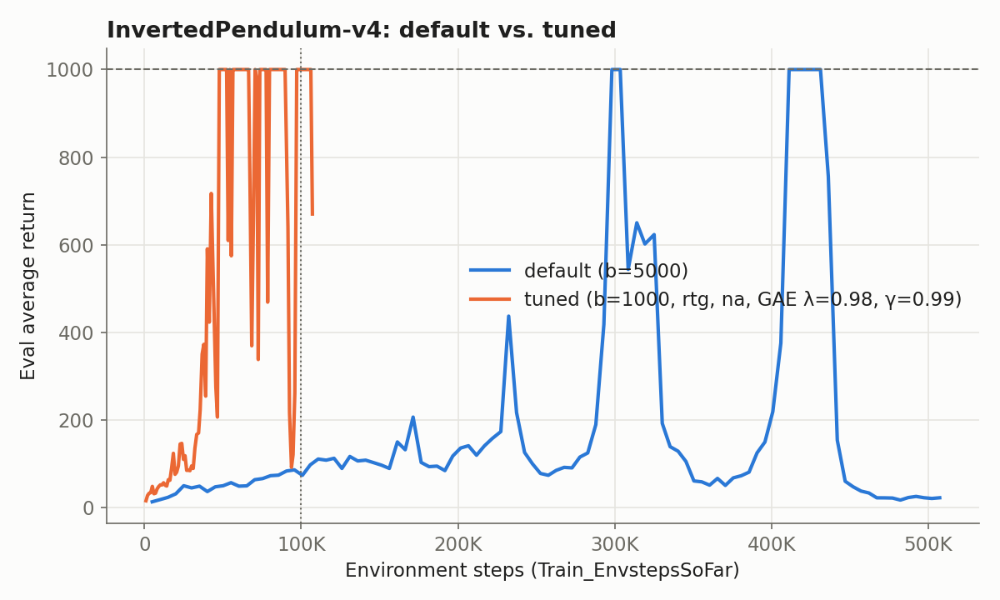

# HW2: Policy Gradients

Implementation and experiments for [CS 285 (UC Berkeley, Spring 2026)](https://rail.eecs.berkeley.edu/deeprlcourse/) Homework 2. I worked through it as a self-study student, running every experiment locally on a laptop CPU.

**What I implemented**

- Vanilla policy gradient (REINFORCE) with discrete (`Categorical`) and continuous (diagonal Gaussian) policies
- Return estimators: full-trajectory discounted return and discounted reward-to-go
- Advantage normalization
- A neural-network value baseline (critic) trained by MSE regression on reward-to-go targets
- Generalized Advantage Estimation (GAE-λ), with trajectory boundaries handled in a flattened batch

| Experiment | Target | Result |
|---|---|---|
| 1. CartPole-v0 | best config reaches 200 (small and large batch) | ✅ reached 200 in every config |
| 2. HalfCheetah-v4 + baseline | eval return > 300 at end of training | ✅ final 443 (last-10 mean 342) |
| 3. LunarLander-v2 + GAE | best run > 150 at least once | ✅ max 237 (λ = 0.98) |
| 4. InvertedPendulum-v4 tuning | return 1000 within 100K env steps | ✅ first hit at **47.8K** steps (default: 298K) |

Figures are generated from the run logs with [`report/plot_results.py`](report/plot_results.py). The x-axis of every learning curve is environment steps (`Train_EnvstepsSoFar`), not iterations.

---

## Key concepts (Q&A)

These are the questions I had to answer for myself while implementing the assignment. Each one connects a line of code to an idea from the lecture. The core code is in [`src/agents/pg_agent.py`](src/agents/pg_agent.py), [`src/networks/policies.py`](src/networks/policies.py), [`src/networks/critics.py`](src/networks/critics.py), and [`src/infrastructure/utils.py`](src/infrastructure/utils.py).

### The policy

**Q. What should the policy's `forward` return?**
A probability distribution over actions, not a single action. Policy gradients need to (1) *sample* actions during rollouts and (2) evaluate `log π(a|s)` for the actions that were taken. A `torch.distributions` object provides both: `.sample()` and a differentiable `.log_prob()`. `torch.distributions.Distribution` itself is an abstract base class, so it cannot be used directly. I used two concrete subclasses:
- Discrete actions: `Categorical(logits=...)`. The network outputs unnormalized logits, not probabilities.
- Continuous actions: `Independent(Normal(mean, exp(logstd)), 1)`

**Q. Why wrap the Gaussian in `Independent`?**
In the policy gradient `∇J ≈ Σ_t ∇log π(a_t|s_t) · A_t`, both factors are **one scalar per timestep**. A HalfCheetah action, however, is a 6-dimensional vector. Its dimensions are sampled independently, so the probability of the whole vector is the product of the per-dimension densities, and the log-probability is their sum. A plain `Normal` returns a `(B, 6)` tensor of per-dimension log-probs. `Independent(..., 1)` treats the last dimension as one event and sums over it, which gives `(B,)` and pairs one-to-one with the advantages. Without it, `(B, 6) * (B,)` either fails or silently broadcasts into a wrong loss.

**Q. Why `exp(logstd)` instead of learning the standard deviation directly?**
A standard deviation must be strictly positive, but gradient descent on a raw parameter can push it to zero or below. Learning `logstd ∈ ℝ` and exponentiating turns this constrained problem into an unconstrained one. It also makes the update scale-invariant: a fixed step in `logstd` changes σ by the same *ratio* whether σ is 1.0 or 0.05. With `logstd` initialized to 0, the policy starts at σ = 1, which gives broad exploration that shrinks as the policy improves.

### The policy-gradient loss

**Q. What is the "loss" for policy gradients?**
PyTorch differentiates a loss; it does not accept a gradient directly. So I need a scalar function whose gradient *is* the policy gradient:

```
L(θ) = −mean_t[ log π_θ(a_t|s_t) · A_t ]
```

- **The minus sign:** the optimizer minimizes, but J(θ) should be maximized.
- **The advantages are constants:** only `log π` is differentiated, so ∇L reproduces the REINFORCE estimator exactly.
- **The value of L is meaningless as a metric.** It is a surrogate that exists only to produce the gradient, so "Actor Loss" can rise while returns improve. Progress should be judged by return.

**Q. Why are advantages computed in NumPy rather than as tensors?**
Because they must act as constants. If `A_t = Q_t − V_φ(s_t)` were kept as a tensor connected to the critic, the actor loss's `backward()` would also update the critic, toward minimizing the actor loss rather than fitting V. Converting to NumPy cuts the autograd graph, just like `.detach()`. The per-element GAE recursion is also much faster in NumPy than in per-element PyTorch ops. The rule I followed: tensors only inside the networks, where gradients are needed; NumPy everywhere else.

### Variance reduction

**Q. Why does reward-to-go reduce variance without adding bias?** (Causality)
An action at time t cannot influence rewards received before t. In expectation, the full-trajectory estimator's past-reward terms multiply a score function with zero mean, so they contribute nothing to the gradient. They still add noise. Reward-to-go removes exactly those terms. In code, the t-th entry is simply the discounted return of the suffix `rewards[t:]`, which can be computed in O(T) with the backward recursion `G_t = r_t + γ G_{t+1}`.

**Q. Why apply discounting relative to the current step (Eq. 11) rather than absolutely (Eq. 10)?**
With absolute discounting `γ^{t'}`, rewards late in an episode are almost erased, so the policy effectively stops learning in states it visits late, even though those states matter just as much. Relative discounting `γ^{t'−t}` only says "prefer sooner rewards from *here*". This is uniform across the episode and matches the stationary objective we actually want, so it is the standard choice.

**Q. Why does a baseline not bias the gradient?**
For any b(s_t) that does not depend on the action: `E_{a∼π}[∇log π(a|s) · b(s)] = b(s) · ∇Σ_a π(a|s) = b(s) · ∇1 = 0`. Subtracting it therefore leaves the expected gradient unchanged. If b ≈ V(s), it removes most of the scale of the return, and with it most of the variance.

**Q. Why does advantage normalization help so much on CartPole?**
Every CartPole reward is +1, so raw returns are always positive and every update increases the probability of *every* sampled action. Only the relative magnitudes differ between actions. After normalization, below-average actions get negative advantages and are actively suppressed. Normalization is technically biased (the statistics come from the same batch), but the bias vanishes as the batch grows.

### The critic and GAE

**Q. What does the critic learn, and how?**
The critic is a plain regression model: `V_φ(s) ≈ E[reward-to-go | s]`, trained with MSE on the reward-to-go targets `Q_t`. It outputs a number, not a distribution. One shape pitfall: the MLP outputs `(B, 1)` and the targets are `(B,)`. Subtracting those two shapes silently broadcasts into a `(B, B)` matrix, so I `squeeze(-1)` the output, and an `assert values.shape == q_values.shape` guards against this.

**Q. Why does GAE need `terminals`?**
After flattening, all trajectories in a batch sit in one array. In the recursion `A_t = δ_t + γλ A_{t+1}`, the next index after a trajectory's last step belongs to a *different* trajectory. At terminal steps I drop the bootstrap and recursive terms (`δ_{H−1} = r_{H−1} − V(s_{H−1})`). The dummy value appended at the end keeps the final index in bounds.

**Q. How do I know the GAE implementation is correct?**
By its two closed forms. With λ = 1 the δ's telescope, so GAE must equal `Q_t − V(s_t)`. With λ = 0 it must equal the one-step TD error δ_t. I unit-tested both on a batch containing two trajectories, and both matched.

---

## Experiment 1: CartPole-v0

`-n 100`, small batch `-b 1000` and large batch `-b 4000`. Flags: `-rtg` = reward-to-go, `-na` = advantage normalization.




| Config | Small batch: first 200 @ steps | Small: last-10 eval mean | Large batch: first 200 @ steps | Large: last-10 eval mean |
|---|---|---|---|---|
| vanilla | 45.9K | 105 | 89.8K | 86 |
| rtg | **16.9K** | **200** | 56.7K | 179 |
| na | 27.7K | **200** | 56.7K | **200** |
| rtg + na | 29.0K | 164 | **44.3K** | 179 |

**Which estimator is better without advantage normalization?** Reward-to-go. With small batches it reached 200 about 2.7× faster than the trajectory-centric estimator (16.9K vs. 45.9K steps) and stayed there. The vanilla estimator never stabilized: its last-10 mean was 105 for small batches and 86 for large batches.

**Why is reward-to-go preferred?** Because of causality: an action at time t cannot affect rewards before t. The trajectory-centric estimator weights every `∇log π(a_t|s_t)` by the full return, past rewards included. Those past rewards are pure noise for that action. They leave the expected gradient unchanged but add variance. Reward-to-go drops them, which gives an unbiased estimator with lower variance.

**Did advantage normalization help?** Yes, especially for the vanilla estimator: its last-10 mean rose from 105 to 200 (small) and from 86 to 200 (large). In CartPole every reward is +1, so raw returns are always positive and every action's probability gets pushed up. Normalization centers the advantages, so below-average actions are actively suppressed. Combined with reward-to-go the gain was smaller. In the small-batch rtg+na run the policy reached 200 but oscillated afterwards, which I attribute mostly to single-seed noise.

**Did batch size matter?** Yes. Large batches gave smoother curves and more reliable convergence: three of four large-batch configs ended at or near 200. However, they needed more environment steps to first reach 200, because each update consumes 4× the data. Small batches are more sample-efficient per update but noisier.

<details>
<summary>Commands</summary>

```bash
uv run src/scripts/run.py --env_name CartPole-v0 -n 100 -b 1000 --exp_name cartpole
uv run src/scripts/run.py --env_name CartPole-v0 -n 100 -b 1000 -rtg --exp_name cartpole_rtg
uv run src/scripts/run.py --env_name CartPole-v0 -n 100 -b 1000 -na --exp_name cartpole_na
uv run src/scripts/run.py --env_name CartPole-v0 -n 100 -b 1000 -rtg -na --exp_name cartpole_rtg_na
uv run src/scripts/run.py --env_name CartPole-v0 -n 100 -b 4000 --exp_name cartpole_lb
uv run src/scripts/run.py --env_name CartPole-v0 -n 100 -b 4000 -rtg --exp_name cartpole_lb_rtg
uv run src/scripts/run.py --env_name CartPole-v0 -n 100 -b 4000 -na --exp_name cartpole_lb_na
uv run src/scripts/run.py --env_name CartPole-v0 -n 100 -b 4000 -rtg -na --exp_name cartpole_lb_rtg_na
```
</details>

---

## Experiment 2: HalfCheetah-v4 with a neural-network baseline




| Run | Final eval return | Last-10 mean | Max |
|---|---|---|---|
| no baseline | −208 | −213 | −178 |
| **baseline (bgs = 5, blr = 0.01)** | **443** | **342** | **505** |
| baseline, bgs = 1 | 239 | 127 | 239 |
| baseline, blr = 0.001 | −94 | −92 | 11 |

**The baseline helps substantially.** Subtracting a learned `V(s)` from reward-to-go lowers the variance of the advantage without adding bias. The baselined agent ended about 650 points above the agent without a baseline.

**Seed variance.** HalfCheetah policy gradients turned out to be highly seed-dependent. I ran the baselined configuration 5 times with identical hyperparameters (seed 1 twice, then seeds 2–4). The final eval returns were 101, 204, −216, 266, and 443. The plotted run is seed 4, the first to clear the 300 threshold at the end of training. Seeds 1 and 2 used the exact same command, yet produced different results. The reason: the starter code seeds NumPy/PyTorch but not `env.reset()`, so the initial states differ between runs.

**Reducing baseline gradient steps or learning rate** (both runs use seed 4, so they are directly comparable to the main run):

- *(a) Baseline learning curve.* With the default critic settings, the loss fell from ~200 to ~30 within the first 50K steps. With `bgs=1` or `blr=0.001`, the critic could not keep up with the changing policy. Its loss *rose* to 360 and 540 respectively, and took ~100K steps to settle. Late in training, all three losses look similar (20–30). These late values are not directly comparable, though, because a worse policy produces smaller-magnitude return targets.
- *(b) Policy performance.* A slower critic means the baseline is inaccurate for longer, so the advantages stay noisy and the policy improves more slowly. The `blr=0.001` run ended near −90; `bgs=1` reached 239. The benefit of a baseline depends on how accurate the critic is. (These are single-seed results; given the seed variance above, they should be read as trends.)

<details>
<summary>Commands</summary>

```bash
# No baseline
uv run src/scripts/run.py --env_name HalfCheetah-v4 -n 100 -b 5000 -eb 3000 -rtg \
  --discount 0.95 -lr 0.01 --exp_name cheetah
# Baseline (submitted run)
uv run src/scripts/run.py --env_name HalfCheetah-v4 -n 100 -b 5000 -eb 3000 -rtg \
  --discount 0.95 -lr 0.01 --use_baseline -blr 0.01 -bgs 5 --exp_name cheetah_baseline --seed 4
# Weaker critic
uv run src/scripts/run.py --env_name HalfCheetah-v4 -n 100 -b 5000 -eb 3000 -rtg \
  --discount 0.95 -lr 0.01 --use_baseline -blr 0.01 -bgs 1 --exp_name cheetah_baseline_bgs1 --seed 4
uv run src/scripts/run.py --env_name HalfCheetah-v4 -n 100 -b 5000 -eb 3000 -rtg \
  --discount 0.95 -lr 0.01 --use_baseline -blr 0.001 -bgs 5 --exp_name cheetah_baseline_blr0.001 --seed 4
```
</details>

---

## Experiment 3: LunarLander-v2 with GAE



| λ | Max eval return | Last-20 mean | First > 150 at iter |
|---|---|---|---|
| 0 | 83 | −100 | never |
| 0.95 | 194 | −60 | 74 |
| **0.98** | **237** | **119** | 116 |
| 0.99 | 217 | 105 | 109 |
| 1 | 239 | 50 | 113 |

**How λ affected performance.** λ = 0 failed to learn. Every λ ≥ 0.95 crossed 150 at some point. λ = 0.98 and 0.99 were the most stable late in training, holding returns above 100. λ = 1 reached a similar peak but oscillated strongly. The late collapse at λ = 0.95 is likely partly seed noise.

**What do λ = 0 and λ = 1 correspond to?**

- **λ = 0:** the advantage is the one-step TD error `δ_t = r_t + γV(s_{t+1}) − V(s_t)`. This is the lowest-variance estimate, but it relies entirely on the critic. Early in training the critic is inaccurate, so the estimate is heavily biased. This is why λ = 0 never learned.
- **λ = 1:** the δ's telescope into the Monte Carlo advantage `G_t − V(s_t)`, which is exactly Experiment 2's baseline estimator. It is unbiased but high-variance, which shows up as the large swings in the λ = 1 curve.
- Intermediate λ (0.98–0.99) trades a little bias for much lower variance, and performed best here.

<details>
<summary>Command</summary>

```bash
uv run src/scripts/run.py --env_name LunarLander-v2 --ep_len 1000 --discount 0.99 \
  -n 200 -b 2000 -eb 2000 -l 3 -s 128 -lr 0.001 --use_reward_to_go --use_baseline \
  --gae_lambda <lambda> --exp_name lunar_lander_lambda<lambda>
# <lambda> ∈ {0, 0.95, 0.98, 0.99, 1}
```
</details>

---

## Experiment 4: Hyperparameter tuning on InvertedPendulum-v4

Goal: reach return 1000 within **100K environment steps** (the default config needs ~300K).



**Tuning runs** (all with `-rtg -na`, ~100K steps each):

| Config | First eval = 1000 @ steps | # evals at 1000 within 100K | Outcome |
|---|---|---|---|
| default: `-b 5000` | 298K | 0 | max 86 within 100K |
| A: `-b 1000 -lr 0.01` | 80.3K | 11 | stable at 1000 at end |
| B: `-b 1000 -lr 0.02` | 58.4K | 4 | collapsed to ~40 afterwards |
| C: `-b 500 -lr 0.01` | — | 0 | too noisy, max 262 |
| **D: `-b 1000 -lr 0.01` + baseline, GAE λ = 0.98, γ = 0.99** | **47.8K** | **36** | **best** |
| E: `-b 2000 -lr 0.02` | — | 0 | too few updates, max 377 |

**Which hyperparameters mattered:**

1. **Batch size mattered most.** The budget is env steps, not iterations. At `-b 5000`, 100K steps buy only 20 updates; at `-b 1000` they buy 100. Too small (`-b 500`) made gradients too noisy to learn, and `-b 2000` allowed too few updates. 1000 was the sweet spot.
2. **Learning rate trades speed for stability.** `lr=0.02` reached 1000 sooner than `lr=0.01` (58K vs. 80K), but then collapsed. `lr=0.01` held its performance.
3. **Variance reduction compensates for small batches.** On top of A, adding a critic baseline with GAE (λ = 0.98) and γ = 0.99 brought the first hit forward from 80K to 48K steps. It also tripled the number of evaluations at 1000. Reward-to-go and advantage normalization were used in every tuned run.

The default run (not tuned) also illustrates PG instability: it reached 1000 twice (around 300K and 410K steps), then collapsed to ~20 by the end of training.

<details>
<summary>Commands</summary>

```bash
# Default
uv run src/scripts/run.py --env_name InvertedPendulum-v4 -n 100 -b 5000 -eb 1000 --exp_name pendulum
# Best (D)
uv run src/scripts/run.py --env_name InvertedPendulum-v4 -n 100 -b 1000 -eb 1000 \
  -rtg -na -lr 0.01 --discount 0.99 --use_baseline --gae_lambda 0.98 --exp_name pendulum_D_b1000_gae
```
</details>

---

## Takeaways

- Policy gradient performance is dominated by **gradient variance**. Every technique that helped (reward-to-go, normalization, baselines, GAE, discounting) is a variance-reduction tool. Each one trades off differently against bias or sample cost.
- **Results vary heavily with the random seed.** Identical HalfCheetah configs ranged from −216 to 443. Conclusions from single runs should be treated as trends, and real comparisons need multiple seeds.
- **Sample efficiency is about the number of updates per environment step**, not the number of iterations. Smaller batches plus stronger variance reduction made InvertedPendulum about 6× more sample-efficient than the default.
